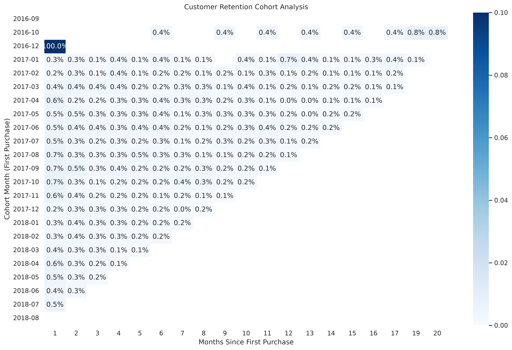
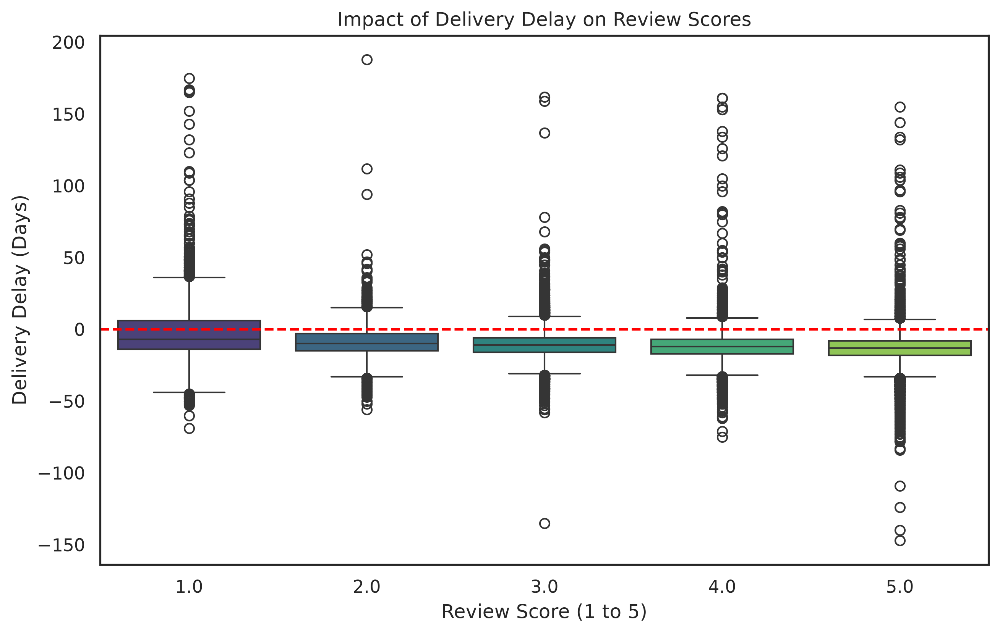
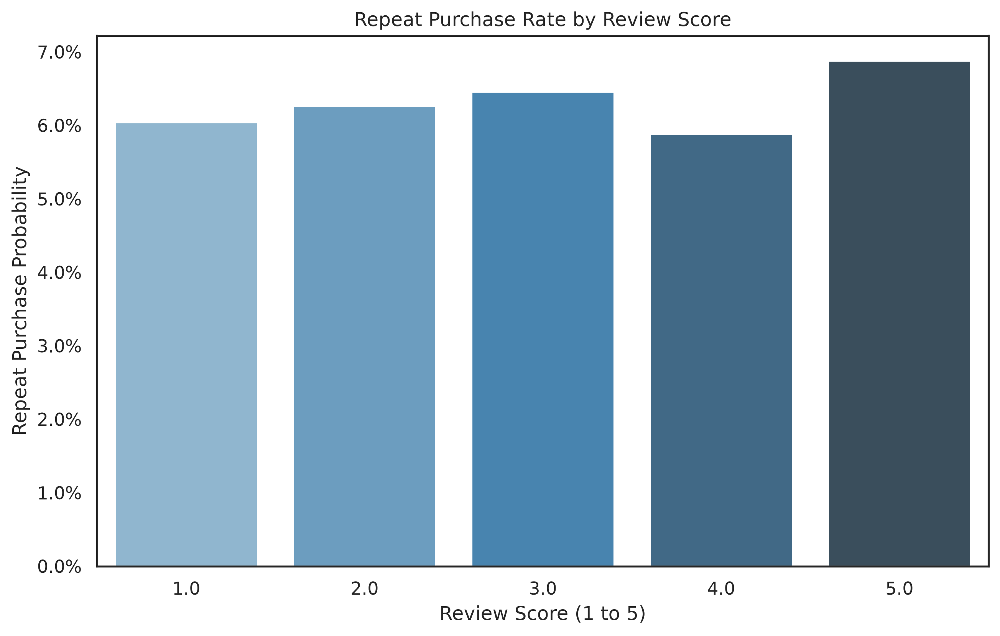

# 📊 E-commerce Retention & Churn Analysis - Olist

## 🎯 Business Context
An e-commerce platform (Olist) is experiencing a high customer churn rate. The management needs to understand **which customer cohorts retain best, exactly where the biggest drop-off occurs, and what concrete actions can be taken to improve retention and Customer Lifetime Value (LTV)**.

## 💡 Project Objectives
1. Calculate the monthly cohort retention matrix.
2. Identify the key drivers of churn (delivery time, product category, payment method, etc.).
3. Design an interactive dashboard with main metrics and an action panel.
4. Propose 3 data-driven business recommendations.

## 🛠️ Tech Stack
- **Language:** Python (Pandas, Numpy, Matplotlib, Seaborn)
- **Database:** SQL (SQLite / PostgreSQL)
- **Visualization:** Power BI / Tableau *(update this based on your choice)*
- **Environment:** Jupyter Notebooks / VS Code

## 📂 Repository Structure
- `notebooks/`: Exploratory Data Analysis (EDA), data cleaning, and metrics calculation in Python.
- `sql/`: SQL queries for extraction, joins, and cohort calculations.
- `dashboard/`: Screenshots and link to the interactive dashboard.
- `reports/`: Executive summary with conclusions and recommendations.
- *(Note: Original datasets are not included in the repo due to size, but are available on [Kaggle](https://www.kaggle.com/datasets/olistbr/brazilian-ecommerce)).*

## 🗺️ Project Roadmap
- [x] Repository structure setup.
- [ ] Data loading and cleaning (EDA).
- [ ] SQL Data Modeling (Joins of the 9 tables).
- [ ] Cohort retention matrix calculation.
- [ ] Churn root cause analysis (delivery, reviews, payments).
- [ ] Dashboard construction.
- [ ] Final Executive Report writing.

## 📈 Initial Findings: Cohort Retention

**Key Insights:**
- **Low baseline retention:** As expected in a non-subscription marketplace, month-1 retention is very low (around 0.3% - 0.8%).
- **Data cleaning:** Filtered out canceled/unavailable orders, reducing the dataset from 99,441 to 96,470 valid delivered orders.
- **Next steps:** Investigate churn drivers, specifically analyzing if delayed deliveries or negative review scores are correlated with customers not returning.

### 🔍 Key Insights: Churn Drivers

#### 1. Logistics drive Satisfaction

Customers who leave 1-star reviews experience median delivery delays above the estimated date. In contrast, 5-star reviews correlate with early deliveries. 

#### 2. The "5-Star" Loyalty Effect

While the overall repeat purchase rate is low (~6%), it peaks for customers who gave a 5-star review. Interestingly, 4-star reviews show a lower retention rate, suggesting that "good enough" service doesn't drive loyalty; only exceptional experiences do.

# Executive Summary: Olist E-commerce Retention Analysis

## 📊 Business Context
The objective of this project was to analyze the retention and churn behavior of customers on the Olist platform, a Brazilian e-commerce marketplace, to identify what drives customers away and how to increase Customer Lifetime Value (LTV).

## 🔍 Key Findings
1. **Low Baseline Retention:** As a non-subscription marketplace, month-1 retention is naturally low (0.3% - 0.8%). Customers buy once and rarely return in the short term.
2. **Logistics is Critical:** There is a direct correlation between delivery delays and negative reviews. Customers who leave 1-star reviews experienced delivery times significantly above the estimated date.
3. **The "5-Star" Effect:** Customers who have a 5-star experience (early delivery, good product) are the most likely to make a repeat purchase. Average or "good enough" (4-star) experiences do not drive loyalty.

## 💡 Actionable Recommendations
1. **Prioritize Logistics in High-Volume States:** Focus on improving delivery times in São Paulo (SP) and Rio de Janeiro (RJ). Ensure estimated delivery dates are realistic to avoid broken promises.
2. **Targeted Retention Campaigns:** Implement a post-purchase email flow specifically targeting customers who gave a 4-star review, offering a discount for their next purchase to convert them into 5-star loyal customers.
3. **Review the 1-Star Process:** Implement a customer service escalation protocol for any order flagged as delayed, offering proactive support before the customer leaves a negative review.